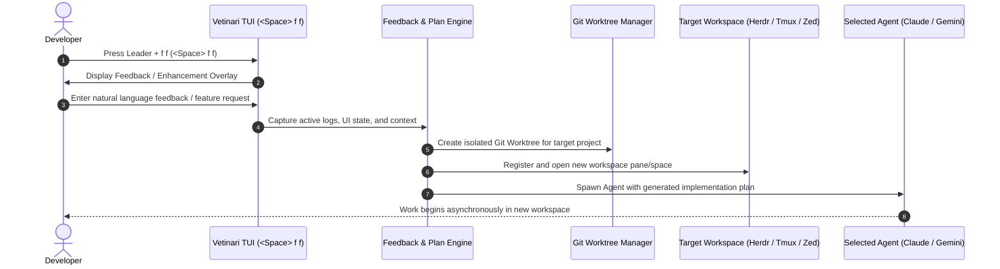

# Product Requirements Document (PRD): **"Vetinari"**
*An Orchestrator for Coding Agents, Attention, and Technical Leadership*

> *"If you have to have a government, you might as well have one that keeps the city running."*  
> — Lord Havelock Vetinari, *Discworld*

---

## 1. Executive Summary & Vision

### 1.1 Overview
**Vetinari** is a Rust-native TUI application and workflow orchestrator named after the Patrician of Ankh-Morpork. Just as Lord Vetinari sits at the center of a web of guilds, messengers, and spymasters to keep the city running silently in the background, **Vetinari** acts as the supreme control plane for developer attention, asynchronous agent orchestration, and technical leadership context.

Vetinari solves cognitive overload caused by multi-tasking across parallel AI coding agents (Claude Code, Gemini via `agy`, custom API callers) while balancing incoming context switches from engineering management tools (Jira, GitHub PRs, Slack, Calendar).

It operates alongside **Herdr** (or other workspace target engines like Zed or standalone tmux sessions) to direct work, manage execution environments, and route human attention precisely where it is needed—including self-improving through built-in feedback-driven workflow execution.

---

## 2. Updated Architecture & System Flow

### 2.1 System Architecture
```mermaid
graph TD
    Vetinari[Vetinari Core TUI Engine]

    subgraph Attention Engine
        Sources[Attention Sources]
        Inboxes[Inboxes / Notifications]
        Calendar[Google / Outlook Calendar]
        Slack[Slack / Messaging]
        Jira[Jira / Issue Trackers]
        PRs[GitHub / GitLab PRs]
        Sources --> Inboxes
        Sources --> Calendar
        Sources --> Slack
        Sources --> Jira
        Sources --> PRs
    end

    subgraph Auth & Security
        AdapterRegistry[Adapter Registry]
        Keyring[OS Keychain via keyring-rs]
        OAuth[OAuth / API Auth Flows]
        AdapterRegistry --> Keyring
        AdapterRegistry --> OAuth
    end

    subgraph Agent Engine
        Agents[Multi-Agent Router]
        Claude[Claude Code CLI]
        Gemini[Gemini via agy / Direct API]
        Custom[Custom API / Script Agents]
        Agents --> Claude
        Agents --> Gemini
        Agents --> Custom
    end

    subgraph Workspace Targets
        Targets[Workspace Orchestrator Trait]
        Herdr[Herdr Socket / IPC]
        Tmux[Dedicated Tmux Session]
        Zed[Zed / External Editor]
        Targets --> Herdr
        Targets --> Tmux
        Targets --> Zed
    end

    Vetinari --> Attention Engine
    Vetinari --> Auth & Security
    Vetinari --> Agent Engine
    Vetinari --> Workspace Targets
```

---

## 3. Key Architectural Decisions

### 3.1 Storage & Credential Security
* **Authentication Engine:** Built-in OS Keychain integration via `keyring-rs`.
* **Auth Flows:** Vetinari manages token storage securely and includes CLI/TUI interactive authentication flows to obtain and renew API keys, OAuth tokens, and session secrets for external integrations (GitHub, Jira, Slack, Gemini/Google AI, Anthropic).

### 3.2 Target Workspace Abstraction (`WorkspaceTarget` Trait)
Vetinari remains fully decoupled from Herdr. Workspace management is governed by a trait interface so Vetinari can target multiple workspace backends:
* **Herdr Target Adapter:** Interfaces via Herdr’s Unix socket / IPC interface to create spaces, switch active spaces, and spawn agent sessions side-by-side.
* **Tmux Target Adapter:** Runs in a distinct, dedicated tmux session, managing its own window/pane tree independently of Herdr.
* **Editor Target Adapter (e.g., Zed):** Interacts via CLI/sockets to open workspaces, branches, or worktrees directly in modern editors.

### 3.3 Keybinding Architecture (Doom Emacs / Modal Vim Inspired)
Vetinari’s UI navigation and control scheme is fully configurable via YAML/TOML configuration files, with **Doom Emacs / Modal Vim** conventions as the default keybinding model:
* **Modal Navigation:** Standard Vim modal navigation (`hjkl` for pane/list movement, `gg` / `G` for top/bottom navigation, `/` for real-time filtering).
* **Leader Key Framework:** Primary actions are triggered using a configurable leader key (Default: `<Space>`).
* **Doom Emacs Keymap Hierarchy:**
  * `<Space> f f` — Feedback / Enhancement mode (Dogfooding engine).
  * `<Space> p r` — Trigger PR review workflow (creates worktree, spawns agent, opens workspace).
  * `<Space> p p` — Switch context profile (Work Profile $\leftrightarrow$ Home Profile).
  * `<Space> s e` — Skill Editor (create/edit agent skills and prompt templates).
  * `<Space> a a` — Agent management menu (view background agents, cancel/re-run tasks).
  * `<Space> w w` — Workspace target navigation (switch Herdr spaces, tmux windows, or Zed contexts).
  * `<Space> m m` — Meeting / Calendar actions (trigger pre-meeting preparation agent).

---

## 4. Core Capabilities & Feature Requirements

### 4.1 Multi-Agent Engine & Skill Harness
Vetinari is agent-agnostic. It coordinates and delegates tasks across different LLMs and CLI tools depending on the specific job requirements.
* **Supported Agent Engines:**
  * **Claude Code CLI** (for interactive, deep codebase modification).
  * **Gemini via `agy` / direct APIs** (for large-context codebase ingestion, fast search, or long-context document analysis).
  * **Direct API Callers & Scripts** (for lightweight background checks, ticket summarization, PR reviews).
* **Skill & Prompt Editor:** Built-in TUI editor to create, version, and assign prompt templates and execution flags to specific agent backends.
* **Task-to-Agent Routing:** Define rules for which agent handles a job (e.g., *“PR Summaries $\rightarrow$ Gemini API via agy; Deep Bug Fix $\rightarrow$ Claude Code inside a worktree”*).

---

### 4.2 Self-Improvement & Feedback Loop ("Dogfooding Engine")
Vetinari includes a native feedback mechanism allowing you to improve Vetinari itself (or any active project) while using it.



* **Feedback Overlay:** Press `<Space> f f` (or custom leader binding) to open an implementation capture prompt.
* **Workflow Generation:** Enter a natural language description of an issue, workflow improvement, or new skill. Vetinari:
  1. Captures current context (logs, active workspace state, active config).
  2. Spawns an implementation workflow using a chosen coding agent.
  3. Automatically isolates the task in a new Git worktree and targets Herdr / Tmux / Zed to open the task environment.

---

## 4.3 Attention Stream & Unified Context Engine
A prioritized, real-time "Inbox" of signals requiring human judgment.

| Source Category | Generic Interface Trait | Specific Adapters | Primary Doom Actions |
| :--- | :--- | :--- | :--- |
| **Code Review & CI** | `CodeHostSource` | GitHub, GitLab | `<Space> p r` (Spawn PR Review Worktree), Approve, Comment |
| **Project Tracking** | `IssueTrackerSource` | Jira, GitHub Issues | `<Space> i u` (Update Status), Assign, Standup Summary |
| **Messaging** | `ChatSource` | Slack, Discord | `<Space> c r` (Reply), Convert to Jira/Task |
| **Calendar** | `ScheduleSource` | Google Calendar, Outlook | `<Space> m p` (Trigger Meeting Prep Agent), View Schedule |
| **Agent States** | `AgentTaskSource` | Herdr, Local Claude Process | `<Space> w s` (Focus Space), `<Space> a u` (Unblock Agent) |

* **Context Mode Toggle:** Instantly switch between **Work Profile** (Jira, Slack, Team PRs) and **Home Profile** (Personal Git repos, slow-burn hobby projects, simple todo lists) via `<Space> p p`.

---

## 5. TUI Layout Strategy & User Experience

Designed for clean terminal aesthetics using `ratatui` with Doom Emacs keybindings:

```
+-----------------------------------------------------------------------------------+
| VETINARI v0.1 - [ Profile: Work ]                     [ Keychain: Authenticated ] |
+-----------------------------------+-----------------------------------------------+
| ATTENTION FEED (Vim hjkl to Move) | WORKSPACE & AGENT MONITOR                     |
| > [PR] #142 Fix memory leak (CI)  | [Space 1] Claude Code: Writing tests (Running)|
|   [JIRA] DEV-891 Review spec      | [Space 2] agy (Gemini): Summarizing PR (Done) |
|   [CAL] Sprint Planning (In 15m)  | [Space 3] Herdr Worktree: Refactoring TUI     |
|   [SLACK] DM from @sarah          +-----------------------------------------------+
|                                   | CONTEXT / DETAILS PANE                        |
|                                   | Title: #142 Fix memory leak in auth parser     |
|                                   | Author: @developer                            |
|                                   | Status: CI Failed                             |
+-----------------------------------+-----------------------------------------------+
| <SPC> p r: PR Review | <SPC> f f: Feedback | <SPC> s e: Edit Skills | <SPC> q: Quit |
+-----------------------------------------------------------------------------------+
```

---

## 6. Technical Stack & Trait Definitions

### Core Dependencies
* **TUI:** `ratatui`, `crossterm`
* **Async Runtime:** `tokio`
* **Secrets:** `keyring-rs`
* **CLI/Process Management:** `tokio::process`, `portable-pty`
* **Serialization/Config:** `serde`, `serde_yaml`

### Target & Agent Trait Specs

```rust
/// Abstract interface for Workspace Orchestrators (Herdr, Tmux, Zed)
#[async_trait]
pub trait WorkspaceTarget: Send + Sync {
    async fn create_space(&self, name: &str, path: &Path) -> Result<SpaceId>;
    async fn focus_space(&self, id: &SpaceId) -> Result<()>;
    async fn close_space(&self, id: &SpaceId) -> Result<()>;
}

/// Abstract interface for Execution Agents
#[async_trait]
pub trait AgentEngine: Send + Sync {
    async fn spawn_task(&self, prompt: &str, context_paths: &[PathBuf]) -> Result<AgentSession>;
    async fn check_status(&self, session_id: &SessionId) -> Result<AgentStatus>;
}
```

---

## 7. Project Implementation Roadmap

* [ ] **Phase 1: Architecture, Keymap Engine & Auth Foundation**
  * Initialize Rust crate structure (`vetinari-core`, `vetinari-tui`, `vetinari-adapters`).
  * Implement modal Vim / Doom Emacs leader key parsing layer.
  * Integrate `keyring-rs` for credential management & TUI key setup wizard.
* [ ] **Phase 2: Target & Agent Abstractions**
  * Implement `WorkspaceTarget` trait with `HerdrSocketTarget` and `TmuxTarget`.
  * Implement `AgentEngine` trait with `ClaudeCodeAgent` and `AgyGeminiAgent`.
* [ ] **Phase 3: Feedback Loop & Self-Enhancement Engine**
  * Build the natural language feedback prompt TUI (`<Space> f f`).
  * Implement automated Git worktree creation + agent spawning workflow.
* [ ] **Phase 4: Multi-Source Attention Adapters**
  * Implement `GitHubSource`, `JiraSource`, `SlackSource`, and `CalendarSource`.
* [ ] **Phase 5: Refinement & Home/Work Profiles**
  * Finalize TUI keybindings, skill editor, and context profile switcher (`<Space> p p`).
```
eof